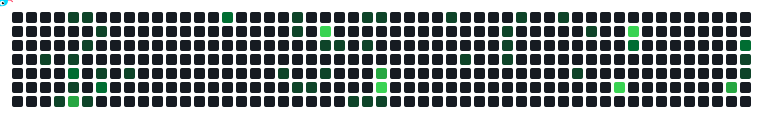

<div align="center">

<!-- Animated Header -->


<a href="https://git.io/typing-svg"></a>


<table>
<tr>
<td>
<a href="https://git.io/typing-svg"></a>
</td>
<td>

</td>
</tr>
</table>

<p>
  <a href="mailto:harshasivaakashsaladi@gmail.com"></a>
  <a href="https://hirishi.vercel.app"></a>
  <a href="https://gitlab.com/hirishi24"></a>
  <a href="https://www.linkedin.com/in/hirishi24"></a>
</p>

<!-- AI Brain Animation -->


</div>

---

## 👨‍💻 About Me

<!-- Coding Animation -->


```yaml
name: Harsha Siva Akash Saladi
location: Amaravati, India
education: B.Tech CSE @ SRM University AP 
role: Student Developer | Research Intern
interests: [TinyML, Computer Vision, Edge AI, Full-Stack]
```

- 🎓 CSE undergraduate with a strong academic foundation (**100% in Class X**, **96.1% in Intermediate**)
- 🔬 Research Intern working on **TinyML** and **Computer Vision** applications
- 🏆 **AP EAPCET 2023** — State Rank **1021** out of 3,00,000+ candidates
- 📚 Currently rebuilding fundamentals with a **growth-first mindset**

<br clear="both">

---

## 🎯 Current Focus

<div align="center">

</div>

```
├── 🧠 Deepening DSA & Problem Solving Skills
├── 🔍 Research: ANPR System for Traffic Enforcement
├── 🌱 Exploring: Edge AI & TinyML Applications
└── 🛠️ Building: Full-Stack Web Projects
```

---

## 🛠️ Skills & Technologies

<div align="center">

</div>

<details open>
<summary><b>💻 Programming Languages</b></summary>
<br>
<p align="center">
  
  
  
</p>
</details>

<details open>
<summary><b>🤖 AI/ML & Data Science</b></summary>
<br>
<p align="center">
  
  
  
  
</p>
</details>

<details open>
<summary><b>🌐 Web Development</b></summary>
<br>
<p align="center">
  
  
  
  
  
  
  
  
</p>
</details>

<details open>
<summary><b>🗄️ Databases</b></summary>
<br>
<p align="center">
  
  
</p>
</details>

<details open>
<summary><b>🧰 Tools & Platforms</b></summary>
<br>
<p align="center">
  
  
  
  
</p>
</details>

<details open>
<summary><b>📖 CS Fundamentals</b></summary>
<br>
<p align="center">
  
  
  
</p>
</details>

---

## 🔬 Research & Experience

<div align="center">

</div>

<table>
<tr>
<td width="50%">

### 🌾 TinyML Pest Detection
**Summer Research Intern @ SRM AP**  
`May 2025 - July 2025`

- Deployed low-power image classification on **Arduino Nano 33 BLE**
- Built hardware-software prototype for **edge inference**
- Co-developing patentable innovation (IP filing in progress)

</td>
<td width="50%">

### 🚗 ANPR System
**Research Intern**  
`August 2025 - Present`

- Building **Automatic Number Plate Recognition** system
- Integrating with **e-challan system** for traffic enforcement
- Focus on reducing manual intervention in violation detection

</td>
</tr>
</table>

---

## 🚀 Projects

<div align="center">

</div>

<table>
<tr>
<td width="100%">

### 📄 Automated Invoice Generator
**Python Application**

Desktop application for generating itemized invoices with GST calculations

**Tech Stack:**
```
Python • Tkinter • ReportLab
```

[](https://github.com/akashsaladi)

</td>
</tr>
</table>

---

## 📊 GitHub Stats

<div align="center">

<a href="https://github.com/akashsaladi">
  
</a>

<br/><br/>

<!-- Snake Animation -->
<picture>
  <source media="(prefers-color-scheme: dark)" srcset="https://raw.githubusercontent.com/akashsaladi/akashsaladi/output/github-snake-dark.svg">
  <source media="(prefers-color-scheme: light)" srcset="https://raw.githubusercontent.com/akashsaladi/akashsaladi/output/github-snake.svg">
  
</picture>

</div>

---

## 🏅 Highlights

<div align="center">

| 🎯 Achievement | 📝 Details |
|:---:|:---|
| 🏆 **AP EAPCET 2023** | State Rank 1021 / 3,00,000+ |
| 📚 **Class X** | 100% Score |
| 📖 **Intermediate** | 96.1% Score |

</div>

---

## 🌐 Let's Connect

<div align="center">
  
<p>
  <a href="mailto:harshasivaakashsaladi@gmail.com">
    
  </a>
  <a href="https://hirishi.vercel.app">
    
  </a>
  <a href="https://www.linkedin.com/in/hirishi24">
    
  </a>
</p>

<br/>

**Languages:** Telugu (Native) • English (Fluent)

---


</div>
